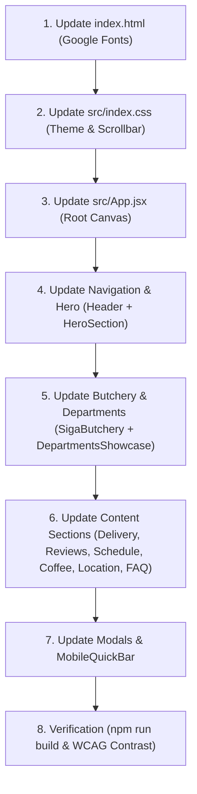

# Y'enat Market — UI Color & Typography Transformation Specification

> **Notice for Cloud Agent / Autonomous LLM:**
> This document is the strict architectural specification for updating the visual styling of **Y'enat Market Website** (`yenat-market-website`).
> **Core Constraint:** DO NOT change layout, component positioning, grid systems, DOM hierarchy, responsive breakpoints, margins/padding scale, button handlers, or component props. **ONLY update color palettes, background surfaces, text colors, borders, and Google Fonts typography.**

---

## 1. Project Essence & Client Feedback

### The Problem with the Current Design
* **Client Feedback:** *"The page is white and looks like paper."*
* **Root Cause:** The current UI heavily relies on stark, flat white backgrounds (`#FFFFFF`) and generic cool/light gray borders (`border-stone-200`). This creates a sterile, clinical "copy paper" look resembling an office document or medical portal rather than an authentic, vibrant Ethiopian culinary market.

### What Y'enat Market (የእናት ገበያ) Actually Is
* **Y'enat Market** is Las Vegas’s premier authentic Ethiopian grocery, 100% grass-fed custom butchery (*Siga* / ስጋ), teff injera bakery, and cultural coffee sanctuary.
* **Key Cultural Touchpoints:**
  1. **Fresh Butchery (*Siga*) & Live Roasting (*Ye Tibs Zigjit*):** Hand-carved pasture-raised beef, sheep, and goats over glowing charcoal pits.
  2. **Highland Teff Injera & Ambasha:** Fermented ancient grains, sourdough warmth, golden baked bread with black nigella seeds.
  3. **Heritage Spices:** Sun-ripened crimson Berbere, fiery golden Mitmita, sacred rue, korarima, and aromatic niter kibe clarified butter.
  4. **Traditional Buna Ceremony:** Hand-roasted Ethiopian coffee beans, smoking frankincense resin, and charcoal embers in clay *jebena* pots.
* **The Visual Objective:** Transform the flat, paper-white aesthetic into a **warm, organic, rich culinary atmosphere** reminiscent of warm toasted teff, sun-baked clay, aged parchment, roasted coffee, and golden clarified butter—without losing high contrast, clean modern legibility, or professional polish.

---

## 2. Global Design Rules & Constraints (For Cloud Agent)

1. **ZERO Layout Changes:**
   * Do NOT change `grid-cols-*`, `flex-*`, `max-w-*`, `gap-*`, `p-*`, `m-*`, `hidden`, or position rules (`relative`, `absolute`, `sticky`, `fixed`).
   * Do NOT reorder sections or remove any cards/buttons.
2. **ONLY Color & Typography Utility Swaps:**
   * Replace sterile `bg-white` and cool backgrounds with warm, tactile earthen surfaces.
   * Replace cool/slate borders (`border-stone-200`) with soft organic warm tones.
   * Replace stark black/dark grays with deep espresso and roasted coffee bean darks (`#1F1612`, `#2E211A`).
   * Harmonize accent colors (Berbere crimson `#B83822`, clarified butter gold `#D48B28`, highland emerald `#1B4D36`).
3. **Accessibility & Contrast:**
   * All body and headline text MUST strictly meet WCAG 2.1 AA contrast ratios (minimum 4.5:1 for normal text, 3:1 for large display titles).
4. **Google Fonts Upgrades:**
   * Elevate the typography to evoke heritage craftsmanship, culinary depth, and warmth, while keeping UI labels crisp and readable.

---

## 3. Recommended Color Palettes

### Primary Palette: **"Warm Highland Earth & Toasted Teff"** (Recommended)
This palette completely eliminates the "paper white" feel, wrapping the customer in the sensory warmth of an Ethiopian kitchen.

| Token Role | Hex Code | Tailwind Equivalent / Replacement Target | Visual Identity Description |
| :--- | :--- | :--- | :--- |
| **Page Base Canvas** | `#F4EFE6` | Replaces `bg-[#FAF7F2]` in `App.jsx` and sections | Warm toasted teff linen, soft organic canvas (never sterile white) |
| **Alternating Section Canvas** | `#ECE4D6` | Replaces alternating `bg-white` section backgrounds | Warm stone / clay-washed parchment for rich visual rhythm |
| **Card / Surface Canvas** | `#FAF6F0` | Replaces `bg-white` on cards & containers | Warm spiced ivory / clotted cream (gentle elevation above page background) |
| **Card Highlight / Wells** | `#F0E8DC` | Replaces `bg-stone-50` / `bg-stone-100` | Warm milled grain well for nested cards and inset panels |
| **Dark Luxury Surface** | `#1A120E` | Replaces `bg-stone-900` / `bg-stone-950` | Rich roasted coffee bean dark (adds warmth over cold neutral black) |
| **Headings & Bold Text** | `#1C1410` | Replaces `text-stone-900` / `text-stone-950` | Deep Ethiopian espresso bean (luxurious, high-contrast, zero paper glare) |
| **Body Reading Text** | `#3D2E24` | Replaces `text-stone-700` / `text-stone-800` | Aged roasted cocoa bean (warm, natural, effortless readability) |
| **Muted / Subtitle Text** | `#756356` | Replaces `text-stone-500` / `text-stone-400` | Korarima husk / soft earth brown |
| **Borders & Dividers** | `#DDD2C1` | Replaces `border-stone-200` | Hand-spun cotton linen divider, subtle and organic |
| **Dark Section Borders** | `#352720` | Replaces `border-stone-800` / `border-stone-700` | Dark roasted timber border |
| **Primary Accent (Berbere)** | `#B83822` | Accent buttons, badges, highlights | Authentic sun-ripened red pepper crimson |
| **Secondary Accent (Kibe Gold)**| `#D48B28` | Stars, ratings, verified badges, borders | Clarified spiced butter (*niter kibe*) amber gold |
| **Freshness Accent (Emerald)** | `#1B4D36` | In-stock badges, WhatsApp CTAs | Highland Ethiopian eucalyptus & fresh pasture green |

---

### Alternative Palette: **"Royal Clay Hearth & Amber Incense"** (Option 2)
For an even deeper, artisanal gourmet feel:
* **Page Base Canvas:** `#EFECE5` (Weathered Riverstone)
* **Card Surface:** `#F7F4EE` (Warm Alabaster)
* **Text Primary:** `#181311` (Smoked Charcoal Timber)
* **Text Body:** `#3B312C` (Deep Umber)
* **Borders:** `#D8D2C6` (Clay Mortar)
* **Accents:** `#C04A26` (Terracotta Fire) & `#E09F2D` (Warm Amber Honey)

---

## 4. Google Fonts Typography Strategy

### Current Setup:
* Display / Headings: `Outfit`
* Body / UI Text: `Plus Jakarta Sans`
* *Issue:* `Outfit` is quite geometric and tech-oriented, giving a slightly corporate or fintech impression rather than an artisan grocery and butchery.

### Recommended Upgrade: **Culinary Heritage & Modern Polish**
We recommend pairing an organic, warm, high-character display font with clean humanist sans:
* **Display / Headings:** **`Fraunces`** (or **`Playfair Display`**)
  * *Why:* `Fraunces` is a warm, soft-serif Google Font with appetizing curves inspired by vintage packaging and artisan culinary typography. It gives immediate warmth and storytelling charm to titles like *"Fresh Meat for Weddings"*, *"100% Grass-Fed Butchery"*, and *"Buna Coffee Ceremony"*.
* **Body & UI Text:** **`Plus Jakarta Sans`** (Retained)
  * *Why:* Outstanding legibility for item prices, weights, phone numbers, hours, and badge pills.

### Code Implementation for Cloud Agent:

#### In `index.html`:
Replace the existing Google Fonts `<link>`:
```html
<!-- PREVIOUS -->
<!-- <link href="https://fonts.googleapis.com/css2?family=Outfit:wght@400;500;600;700;800&family=Plus+Jakarta+Sans:wght@300;400;500;600;700&display=swap" rel="stylesheet" /> -->

<!-- NEW (Warm Culinary Heritage) -->
<link rel="preconnect" href="https://fonts.googleapis.com" />
<link rel="preconnect" href="https://fonts.gstatic.com" crossorigin />
<link href="https://fonts.googleapis.com/css2?family=Fraunces:ital,opsz,wght@0,9..144,500;0,9..144,600;0,9..144,700;0,9..144,800;1,9..144,600&family=Plus+Jakarta+Sans:wght@300;400;500;600;700;800&display=swap" rel="stylesheet" />
```

#### In `src/index.css`:
Update font declarations:
```css
@import "tailwindcss";

@theme {
  --font-sans: "Plus Jakarta Sans", system-ui, -apple-system, sans-serif;
  --font-display: "Fraunces", Georgia, serif;
}
```

---

## 5. Detailed Component-by-Component Transformation Blueprint

The Cloud Agent should apply the following token mappings across each file without changing layout or element structure:

### 1. Root & Global Styles
* **`src/App.jsx`**:
  * Line 24: Change root wrapper from:
    `className="min-h-screen flex flex-col overflow-x-hidden bg-[#FAF7F2] text-stone-900 selection:bg-amber-300 selection:text-stone-950"`
    to:
    `className="min-h-screen flex flex-col overflow-x-hidden bg-[#F4EFE6] text-[#1C1410] selection:bg-[#E8AF44] selection:text-[#1A120E]"`

* **`src/index.css`**:
  * Scrollbar track: Change `bg-[#FAF7F2]` to `bg-[#F4EFE6]`
  * Scrollbar thumb: Change `bg-stone-300` to `bg-[#DDD2C1]`, hover to `bg-[#C8BAA5]`

---

### 2. Header & Navigation (`src/components/Header.jsx`)
* **Header Bar:**
  * Background: Change `bg-[#FAF7F2]/95` to `bg-[#F4EFE6]/95 backdrop-blur-md`
  * Border: Change `border-stone-200/80` to `border-[#DDD2C1]`
* **Logo Box:**
  * Change `bg-white border-stone-200` to `bg-[#FAF6F0] border-[#DDD2C1]`
* **Navigation Links:**
  * Inactive state: `text-[#4D3B30] hover:text-[#1C1410] hover:bg-[#ECE4D6]/70`
  * Active state pill: `text-[#1C1410] bg-[#ECE4D6] border border-[#DDD2C1]`
* **Call / Action Buttons:**
  * Phone CTA: `bg-[#1A120E] text-[#FAF6F0] hover:bg-[#2C1F18]`
* **Mobile Menu Drawer:**
  * Change `bg-white border-stone-200` to `bg-[#FAF6F0] border-[#DDD2C1]`

---

### 3. Hero Section (`src/components/HeroSection.jsx`)
* **Section Canvas:**
  * Change `bg-gradient-to-b from-amber-50/50 via-[#FAF7F2] to-[#FAF7F2]`
  * to: `bg-gradient-to-b from-[#ECE4D6] via-[#F4EFE6] to-[#F4EFE6] border-[#DDD2C1]`
* **Headings & Accents:**
  * Headline: `text-[#1C1410]`
  * Subtitle: `text-[#4D3B30]`
  * Highlights / Badges: `bg-[#EBDDC8] text-[#7A3E14] border-[#DFCBB0]`
* **3D Payment Card Frame (EBT, Zelle, Visa):**
  * Outer card wrap: Change `bg-white border-stone-200` to `bg-[#FAF6F0] border-[#DDD2C1] shadow-md`
  * Inset details box: Change `bg-stone-50` to `bg-[#F0E8DC] border-[#E3D7C5]`

---

### 4. Fresh Butchery Section (`src/components/SigaButcherySection.jsx`)
* **Section Background:**
  * Change `bg-white` (which looked like paper!) to rich alternating tone: `bg-[#ECE4D6] border-[#DDD2C1]`
* **Meat Cut Product Cards (`SIGA_CUTS`):**
  * Change card container: from `bg-white border-stone-200 hover:border-amber-400`
  * to: `bg-[#FAF6F0] border-[#DDD2C1] hover:border-[#D48B28] shadow-xs hover:shadow-md transition-all`
  * Meat cut title: `text-[#1C1410]`
  * Amharic name: `text-[#B83822]` (rich Berbere red instead of muted gray)
  * Description text: `text-[#4D3B30]`
  * Tags & badges: `bg-[#F0E8DC] text-[#4D3B30] border-[#DFCBB0]`
* **Ceremony & Live Roasting Showcase (Right Panel):**
  * Keep dark contrast luxury hearth look: `bg-[#1A120E] border-[#352720]`
  * Accents: `text-[#F1A83B]` (golden embers)
  * Feature callouts: `bg-[#251B15] border-[#3D2C22] text-[#E8DDD4]`

---

### 5. Departments Showcase (`src/components/DepartmentsShowcase.jsx`)
* **Section Canvas:**
  * Change `bg-[#FAF7F2]` to `bg-[#F4EFE6] border-[#DDD2C1]`
* **Search Input:**
  * Change `bg-white border-stone-200 placeholder:text-stone-400 text-stone-900`
  * to: `bg-[#FAF6F0] border-[#DDD2C1] placeholder:text-[#8C7A6D] text-[#1C1410] focus:border-[#B83822] focus:ring-[#B83822]/20`
* **Department Filter Tabs:**
  * Inactive tab: `bg-[#FAF6F0] border-[#DDD2C1] text-[#4D3B30] hover:bg-[#F0E8DC]`
  * Active tab: `bg-[#1A120E] text-[#FAF6F0] border-[#1A120E]`
* **Product Catalog Item Cards:**
  * Change `bg-white border-stone-200 shadow-2xs`
  * to: `bg-[#FAF6F0] border-[#DDD2C1] shadow-xs hover:shadow-md transition-all`
  * Card title: `text-[#1C1410]`
  * Card subtitle/Amharic: `text-[#B83822]`
  * Description: `text-[#4D3B30]`
  * Department badge: `bg-[#EBDDC8] text-[#5C3B1E] border-[#DFCBB0]`
  * Freshness indicator: `bg-[#E2F0E7] text-[#15462D] border-[#BADDC8]`
  * Unit/Price pill: `bg-[#F0E8DC] text-[#3D2E24] font-bold`

---

### 6. Delivery Van Service Section (`src/components/DeliveryServiceSection.jsx`)
* **Section Canvas:**
  * Change `bg-[#FAF7F2]` to `bg-[#ECE4D6] border-[#DDD2C1]`
* **Feature & Guarantee Cards:**
  * Change `bg-white border-stone-200` to `bg-[#FAF6F0] border-[#DDD2C1] shadow-xs`
  * Card titles: `text-[#1C1410]`
  * Card descriptions: `text-[#4D3B30]`
  * Delivery schedule banner: `bg-[#EBDDC8]/70 border-[#DFCBB0] text-[#4D3B30]`
* **CTA Buttons:**
  * WhatsApp Button: `bg-[#1B4D36] hover:bg-[#163E2B] text-white shadow-xs`
  * Call Dispatch: `bg-[#FAF6F0] border-[#DDD2C1] text-[#1C1410] hover:bg-[#F0E8DC]`

---

### 7. Celebrity & Community Reviews (`src/components/CelebrityReviewsSection.jsx`)
* **Section Canvas:**
  * Change `bg-white` (paper feel) to `bg-[#F4EFE6] border-[#DDD2C1]`
* **Review Cards:**
  * Card background: Change `bg-white border-stone-200` to `bg-[#FAF6F0] border-[#DDD2C1] shadow-xs`
  * Quote text: `text-[#3D2E24]`
  * Author & handle: `text-[#1C1410]`
  * Verified visitor pill: `bg-[#EBDDC8] text-[#633C14]`
* **Stat / Trust Counters:**
  * Change `bg-white border-stone-200` to `bg-[#FAF6F0] border-[#DDD2C1]`
  * Stat numbers: `text-[#B83822]` (Berbere crimson accent)
  * Stat label: `text-[#4D3B30]`

---

### 8. Fresh Schedule Timetable (`src/components/FreshScheduleSection.jsx`)
* **Section Canvas:**
  * Change `bg-[#FAF7F2]` to `bg-[#ECE4D6] border-[#DDD2C1]`
* **Schedule Cards / Rows:**
  * Change `bg-white border-stone-200` to `bg-[#FAF6F0] border-[#DDD2C1]`
  * Day / Time badge: `bg-[#1A120E] text-[#FAF6F0]`
  * Item highlight: `text-[#1C1410] font-bold`
  * Status tag: `bg-[#E2F0E7] text-[#15462D] border-[#BADDC8]`

---

### 9. B2B & Wholesale Vendor Hub (`src/components/VendorWholesaleSection.jsx`)
* **Section Canvas:**
  * Already utilizes a dark theme: preserve rich dark atmosphere!
  * Shift cool charcoal `bg-stone-900 border-stone-800` to warm roasted coffee dark:
    `bg-[#1A120E] border-[#352720] text-[#E8DDD4]`
  * Feature boxes: `bg-[#251B15] border-[#3D2C22]`
  * Highlight badge: `bg-[#B83822]/20 border-[#B83822]/40 text-[#FFA494]`

---

### 10. Coffee Ritual & Buna Ceremony (`src/components/CoffeeRitualSection.jsx`)
* **Section Canvas:**
  * Change `bg-[#FAF7F2]` to `bg-[#F4EFE6] border-[#DDD2C1]`
* **Step Cards (Abol, Tona, Bereka):**
  * Change `bg-white border-stone-200/80` to `bg-[#FAF6F0] border-[#DDD2C1] shadow-xs`
  * Cup number badge: `bg-[#EBDDC8] text-[#5C3B1E]`
  * Step Title: `text-[#1C1410]`
  * Step Meaning & Details: `text-[#4D3B30]`

---

### 11. Location, Suite 102 & Hours (`src/components/LocationAndHours.jsx`)
* **Section Canvas:**
  * Change `bg-[#FAF7F2]` to `bg-[#ECE4D6] border-[#DDD2C1]`
* **Info Cards (Address, Hours, Payment Badges):**
  * Change `bg-white border-stone-200` to `bg-[#FAF6F0] border-[#DDD2C1] shadow-xs`
  * Headings: `text-[#1C1410]`
  * Detail text: `text-[#4D3B30]`
  * Open daily badge: `bg-[#E2F0E7] text-[#15462D] border-[#BADDC8]`
  * Payment method pills (EBT, Zelle, Visa): `bg-[#F0E8DC] border-[#DDD2C1] text-[#3D2E24]`

---

### 12. Frequently Asked Questions (`src/components/FaqSection.jsx`)
* **Section Canvas:**
  * Change `bg-white` (paper feel) to `bg-[#F4EFE6] border-[#DDD2C1]`
* **Accordion Item Boxes:**
  * Change `bg-white border-stone-200` to `bg-[#FAF6F0] border-[#DDD2C1] shadow-2xs`
  * Question text: `text-[#1C1410]`
  * Answer text: `text-[#4D3B30]`
  * Active question highlight: `border-[#D48B28]/60 bg-[#FAF6F0]`

---

### 13. Modals & Overlays
* **`ItemDetailModal.jsx`**:
  * Modal dialog card: Change `bg-white border-stone-200` to `bg-[#FAF6F0] border-[#DDD2C1]`
  * Info grid boxes: Change `bg-[#FAF7F2] border-stone-200` to `bg-[#F0E8DC] border-[#E3D7C5]`
  * Close button: `bg-[#FAF6F0] text-[#1C1410] hover:bg-[#F0E8DC]`
  * Footer action bar: `bg-[#F0E8DC] border-[#DDD2C1]`

* **`VendorModal.jsx`**:
  * Dialog window: Change `bg-white border-stone-200` to `bg-[#FAF6F0] border-[#DDD2C1]`
  * Header area: Change `bg-[#FAF7F2] border-stone-200` to `bg-[#F0E8DC] border-[#DDD2C1]`
  * Form inputs: `bg-[#FAF6F0] border-[#DDD2C1] text-[#1C1410] focus:border-[#B83822]`

* **`MobileQuickBar.jsx`**:
  * Bottom sticky bar: Change `bg-white/95 border-stone-200` to `bg-[#FAF6F0]/95 border-[#DDD2C1] backdrop-blur-md`
  * Action buttons: Call Butchery `bg-[#1A120E] text-[#FAF6F0]`, WhatsApp `bg-[#1B4D36] text-white`

---

## 6. Step-by-Step Execution Plan for Cloud Agent

Follow these exact steps in sequence to safely apply the UI upgrade:



### Execution Checklist:
1. [ ] **Step 1:** In `index.html`, replace the Google Fonts link to import `Fraunces` and `Plus Jakarta Sans`.
2. [ ] **Step 2:** In `src/index.css`, update `@theme` font definitions (`--font-display: "Fraunces", Georgia, serif;`) and update scrollbar track colors.
3. [ ] **Step 3:** In `src/App.jsx`, update the root wrapper background to `bg-[#F4EFE6]` and default text to `text-[#1C1410]`.
4. [ ] **Step 4:** In `src/components/Header.jsx` and `HeroSection.jsx`, replace `bg-white` and `bg-[#FAF7F2]` with `#FAF6F0`, `#F4EFE6`, and `#ECE4D6`.
5. [ ] **Step 5:** In `src/components/SigaButcherySection.jsx` and `DepartmentsShowcase.jsx`, replace paper-white backgrounds with warm earthen cards (`#FAF6F0`), borders with `#DDD2C1`, and Amharic highlights with Berbere crimson (`#B83822`).
6. [ ] **Step 6:** In remaining content sections (`DeliveryServiceSection.jsx`, `CelebrityReviewsSection.jsx`, `FreshScheduleSection.jsx`, `CoffeeRitualSection.jsx`, `LocationAndHours.jsx`, `FaqSection.jsx`), apply the alternating section colors (`#ECE4D6` / `#F4EFE6`) and warm card surfaces (`#FAF6F0`).
7. [ ] **Step 7:** In `ItemDetailModal.jsx`, `VendorModal.jsx`, and `MobileQuickBar.jsx`, update surface and border tokens to match.
8. [ ] **Step 8:** Run `npm run build` in terminal to confirm zero syntax errors and verify that all UI elements render flawlessly.

---

## 7. Contrast & Accessibility Reference Table

| Foreground (Text) | Background (Surface) | Calculated Contrast Ratio | WCAG 2.1 AA Status | Purpose |
| :--- | :--- | :--- | :--- | :--- |
| `#1C1410` (Espresso) | `#F4EFE6` (Teff Canvas) | **14.8 : 1** | PASS (AAA) | Page Title & Section Headings |
| `#3D2E24` (Aged Umber) | `#FAF6F0` (Card Canvas) | **10.7 : 1** | PASS (AAA) | Long Body Text & Descriptions |
| `#1C1410` (Espresso) | `#FAF6F0` (Card Canvas) | **15.6 : 1** | PASS (AAA) | Product Titles & Modal Headings |
| `#B83822` (Berbere Red) | `#FAF6F0` (Card Canvas) | **5.4 : 1** | PASS (AA) | Amharic Script & Category Badges |
| `#15462D` (Forest Green) | `#E2F0E7` (Soft Mint) | **7.6 : 1** | PASS (AAA) | Fresh In-Stock Indicators |
| `#FAF6F0` (Warm Ivory) | `#1A120E` (Hearth Dark) | **15.6 : 1** | PASS (AAA) | Dark Section Text & Butchery Panel |
| `#FAF6F0` (Warm Ivory) | `#1B4D36` (Emerald CTA) | **7.8 : 1** | PASS (AAA) | WhatsApp & Action Buttons |

**Conclusion for Cloud Agent:** All specified colors eliminate the clinical paper-white look while providing superior legibility and an authentic Ethiopian cultural identity. Proceed directly with the color and typography replacement plan.

